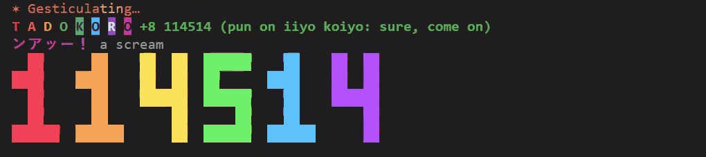
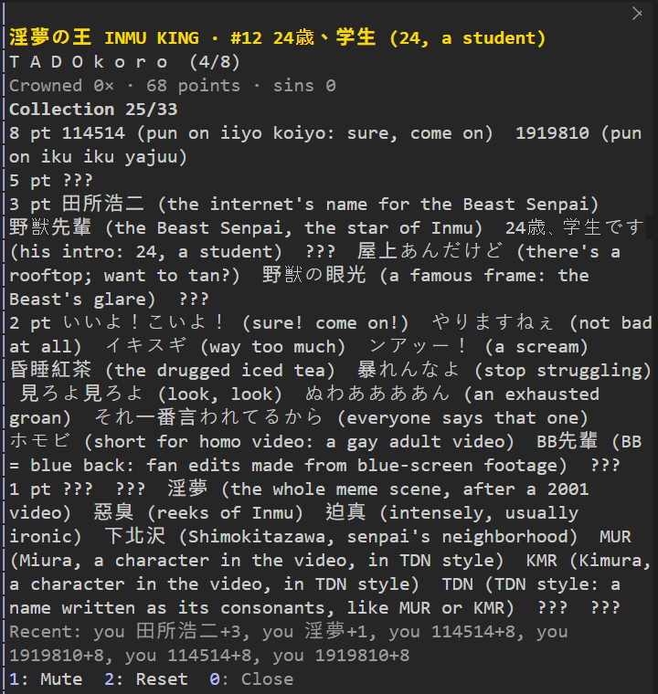

[English](README.md) | 繁體中文 | [日本語](README.ja.md)

# inmu-king

Claude Code 的搞怪 mod。你或 Claude 每打出一個淫夢梗，prompt 上方的 **T A D O K O R O** 就亮幾個字母，每個字母一種彩虹色，旁邊閃兩秒「+3 田所浩二（網路上對野獸學長的通稱）」。梗保留日文，括號裡是它的意思，看不懂梗也能跟著玩；介面設成日文時，梗旁邊不加註解。八個字母全亮是「爆發」：一句老梗台詞、一張會動的像素圖、一段 8-bit 音效，排行榜往上爬一名，從第 20 名開始。爬到第 1 名是「加冕」：像素人群跳舞、播放號角，Claude 下一則回覆的結尾會多一句「やりますねぇ！」。找到的梗會收進「梗圖鑑」，回合結束那行的秒數會改寫成只用 114514 的算式。



<sub>截圖是英文介面。</sub>

靈感來自 2026 年 8 月 10 日上架的 AI 生成歌曲《INMU KING》，以及二十年的淫夢文化。mod 只借用歌名；台詞與稱號都是這首歌出現前就有的老梗，或是這個 mod 自己寫的句子。圖與音效全部原創。

## 長什麼樣

```
T A D O K O R O  #17 下北沢の新入り 下北澤新人  i: 面板               ← 平常的 band
T A D O K O R O  +3 田所浩二（網路上對野獸學長的通稱） NEW!  #17 …       ← 得分，兩秒
T A D O K O R O  +8 114514（諧音いいよこいよ＝好啊，來吧） NEW!          ← 爆發，三秒：
いいよ！こいよ！ 好啊！來吧！                                              觸發的梗、台詞、
（像素圖，三張輪流：戴皇冠的野獸會瞪眼、冰紅茶一格一格喝乾、彩虹 114514）     像素圖
👑 INMU KING 降臨 👑                                                    ← 加冕，六秒
（三個戴皇冠的像素小人輪流舉手跳舞）
```


亮的字母各有一種彩虹色，暗的字母是灰色，剛亮的字母會反白兩秒。爆發時八個字母全亮，只是畫面效果；爆發結束後，字母回到實際的格數，超過八格的分數已經亮著。band 關掉時，改由 prompt 下方的狀態列顯示名次：`淫夢 #17 下北沢の新入り（下北澤新人） · T A D O K o r o`，大寫是亮的，小寫是暗的。

回合結束那行，秒數改寫成 114514 算式：


## 怎麼算分

| 你打的字 | 亮幾格 |
|---|---|
| `114514`、`1919810` | 8，直接爆發 |
| `INMU KING`、`淫夢の王` | 5 |
| `田所浩二`、`野獣先輩`、`24歳、学生です`、`屋上あんだけど`、`野獣の眼光`、`11:45:14` | 3 |
| `いいよ！こいよ！`、`やりますねぇ`、`イキスギ`、`ンアッー`、`昏睡紅茶`、`暴れんなよ`、`見ろよ見ろよ`、`ぬわああああん`、`それ一番言われてるから`、`ホモビ`、`BB先輩`、`野獣の日` | 2 |
| `淫夢`、`惡臭`、`迫真`、`下北沢`、`1919`、`810`、`MUR`、`KMR`、`TDN` | 1 |

- 數字與英文字只算「整個 token」，左右不能緊貼英文字母、數字或底線：`port 8100` 不算 810，`build114514x` 不算 114514，`INMU KINGDOM` 不算 INMU KING。數字後面緊接的 w 笑（一串小寫 w）照算：`114514www`。緊貼中日文照算：`MUR大先輩`、`tadokoroさん`。
- `$` 後面、小數裡、`檔名:行號` 裡的數字不算：`$1,810`、`1.1919`、`foo.ts:810`。`1145141919810` 一次算兩個大獎。
- 全形數字、半形片假名照算：`１１４５１４`、`ｲｷｽｷﾞ`。分成幾段的梗，段與段之間可以有空白或標點：`いいよ、来いよ`、`いいよ・こいよ`、`見ろよ 見ろよ`。日文日常用語不算：`サインアップ`、`ファッション`、沒有ぇ的「やりますね」。
- 同一段文字裡每個梗只算一次，一段最多亮兩輪，也就是 16 分。
- Claude 自己的回覆也算，但只有一半分數，無條件進位。被中斷的回覆和子 agent 的回覆不算。可在設定關掉。
- 工具出錯或被拒是一次「罪」：第一次與每第五次會 toast 一句，並播一段嘆氣音效。
- 每個 session 各玩各的：從 #20 開始（8 月 10 日則一開始就加冕），分數、加冕次數與圖鑑只在這個 session 內有效（熱重載、改設定都不會歸零），下一個 session 重新開始。

## 稱號階梯

| 名次 | 稱號 |
|---|---|
| 20–16 | 下北沢の新入り |
| 15–11 | 24歳、学生 |
| 10–6 | 水泳部の先輩 |
| 5–3 | 野獣 |
| 2 | 野獣先輩 |
| 1 | 淫夢の王 INMU KING |

第 10 名起，轉圈的字會換成「ンアッー」「やりますねぇ」這類；第 1 名時是「INMU KING 👑」。一個回合超過兩分鐘，轉圈字變「アイスティー準備中」。

## 梗圖鑑

每個梗第一次被打出來就收進圖鑑，得分提示會標 `NEW!`。面板依分數分五排列出全部 33 個梗，找到的會附上意思（日文介面只顯示梗本身），還沒找到的顯示 `???`。圖鑑只在這個 session 內有效；`/inmu reset` 不清圖鑑，`/inmu reset all` 才會清。



## 語言

`/config` 的 *Language* 決定 band、面板、`/inmu` 回覆的語言，以及梗旁邊的意思用哪種語言：

- `auto`（預設）：跟著 Claude Code 自己的語言設定（`zh-tw`、`Traditional Chinese`、`繁體中文`、`ja`、`日本語` 這類寫法都認得），沒有就看系統 locale，再沒有就用英文。
- `zh-TW`：繁體中文，例如「やりますねぇ（挺行的嘛）」。
- `en`：英文，例如「やりますねぇ (not bad at all)」。
- `ja`：日文，梗旁邊不加註解，例如「やりますねぇ」。

梗本身一律保留日文。

## 音效

內建四段原創 8-bit 音效，放在 `sounds/`：得分、爆發、加冕、罪。產生它們的腳本是 `tools/make_sounds.py`，只用 Python 標準函式庫。

**你自己的音檔**放在這個資料夾，就會取代內建音效：

```
Windows：C:\Users\<你>\.claude\inmu-king\sounds\
macOS：  ~/.claude/inmu-king/sounds/
```

也可以在 `/config` 的 *Your sound folder* 改成別的資料夾。

| 檔名 | 什麼時候播 |
|---|---|
| `hit`、`burst`、`crown`、`sin` | 得分、爆發、加冕、罪 |
| 梗的 id，例如 `iiyo`、`yarimasu`、`114514` | 打出那個梗時 |
| 梗的文字，例如 `やりますねぇ`、`いいよこいよ`、`田所浩二` | 同上，標點與空白可省略 |

- 格式：wav、mp3、m4a、wma、aac。
- 同一個名字加 `-2`、`-3` 可以放好幾個，輪流播，例如 `burst.wav`、`burst-2.mp3`。
- 得分時，梗自己的音檔會取代得分音效；爆發與加冕時，先播梗的音檔，再播事件音效。
- 放好後打 `/inmu sounds`，會重新掃描資料夾，列出認得與認不得的檔名，以及所有可用的名字。
- 這個資料夾在 repo 外面，你的音檔不會被 commit。

## 時間梗

- 每天 **11:45:14**：自動加 3 分，toast「淫夢時間」；當時開著的每個 session 各一次。
- **8 月 10 日**，野獣の日：當天每個 session 一開始就加冕。

## 指令

```
/inmu              看排行、字母、累計與圖鑑，並開面板
/inmu burst        示範爆發：只播畫面和音效，不加分、不改排名
/inmu king         示範加冕：只播畫面和音效，不改排名，Claude 也不會被感染
/inmu sounds       重新掃描你的音檔資料夾並列出結果
/inmu mute|unmute  這個 session 靜音／開聲音
/inmu reset        歸零：第 20 名、字母全暗、累計清空，圖鑑保留
/inmu reset all    連圖鑑一起清
/inmu band on|off  顯示／隱藏 band（隱藏時，名次改顯示在狀態列）
/inmu homo 1919    把數字寫成 114514 算式
```

面板可以用 `/inmu` 打開，也可以用 band 上的 `i: 面板` 按鈕：fullscreen 模式可以直接點；或先按 `ctrl+x` 再按 `tab`，讓 band 取得焦點，再按 `i`。直接在輸入框打 `i` 不會觸發。面板有三顆按鈕：靜音（1）、歸零（2）、關閉（0）。歸零不會解除靜音。Esc 關面板。

## 設定（`/config`）

| 設定 | 預設 | 說明 |
|---|---|---|
| Sound effects | 開 | 所有音效。Windows 走 PowerShell，macOS 走 Claude Code 內建播放，其他平台沒聲音。 |
| Your sound folder | 空白 | 你的音檔資料夾；空白就用 `~/.claude/inmu-king/sounds`。 |
| Infect Claude at #1 | 開 | 加冕後的下一則回覆結尾加「やりますねぇ！」。做法是那一回合多一段 system prompt，所以 prompt cache 會重建一次。`-p` 與 SDK 的 session 一律不加。你要求「只要 JSON」這類固定格式時，那段 system prompt 會請 Claude 略過這句；這只是對模型的要求，不是保證。 |
| Claude's replies count too | 開 | Claude 回覆裡的梗算半分。 |
| Show the band | 開 | 關掉就不畫 band，名次改顯示在 prompt 下方的狀態列；其他照常。 |
| Language | auto | 見上面的「語言」。 |

## 安裝

```
/plugin marketplace add harry18456/cc
/plugin install inmu-king@harry18456
```

或本機載入：

```
claude --plugin-dir <這個 repo 的路徑>
```

## 開發

```
claude plugin test .           # 118 個測試，不連網
claude plugin validate .
```

`tsc` 需要 Claude Code 載入 mod 時寫進 `.claude-plugin/types/` 的型別檔（git 不追蹤）：先跑一次 `claude --plugin-dir .` 再離開，然後 `npx -p typescript tsc --noEmit -p .`。

同一個 session 載入兩次 mod 時，會有兩份同時在跑，各玩各的，也會畫出兩條 band。這發生在「session 開始時已經載入，之後又熱重載加進來」的情況；遇到時請重開 session，不要熱重載。

## 它做了什麼、沒做什麼

- 只讀你送出的 prompt 與 Claude 的回覆做字串比對。不改 prompt、不連網、不呼叫模型。
- 唯一會進到模型的是「加冕回覆」那一段 system prompt，可以關掉。
- 不存任何東西：遊戲只在這個 session 內，Claude Code 的 plugin store 完全不讀也不寫。舊版留下的存檔（`~/.claude/plugins/store/inmu-king*.json`）會原封不動地留著、不會被讀；想刪可以自己刪。
- 別的 mod 也在這裡畫 band 時，它的內容會疊在這條 band 下面。Claude Code 顯示自己的意見問卷時，整條 band 會讓位。
- Windows 的音效由 PowerShell 播放，每次約 1 秒才出聲，在背景跑，不擋回合。
- 像素圖只在終端機畫；Desktop 上只顯示文字。

## 內容

台詞與稱號是公開迷因的短句，或這個 mod 自己寫的句子；歌曲只借用歌名。圖與音效都是原創。野獸先輩是真人，所以 mod 不畫他的臉，也不附原片的聲音；`TDN` 只算縮寫這種命名法，不比對它背後的真人姓氏。你自己放的音檔由你負責。

## 致謝

- 歌名《INMU KING》：やじゅまんぼう（YAJU-MC）。
- 114514 算式的點子來自 [itorr/homo](https://github.com/itorr/homo)（恶臭数字论证器，MIT）。這裡的表是重新生成的，不是複製的。

MIT License。
